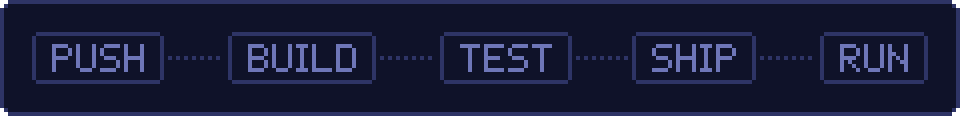

  

  7+ years shipping production systems. 
  <b>Rust</b> and <b>TypeScript</b> on the code side · Kubernetes, GitOps and IaC on the ops side.

  

  

  

  CKA · AWS Cloud Practitioner · M.Sc. System Engineering · Ukrainian (native) · English (B2) 
  Open to full-time, contract and consulting · $45–65/h

